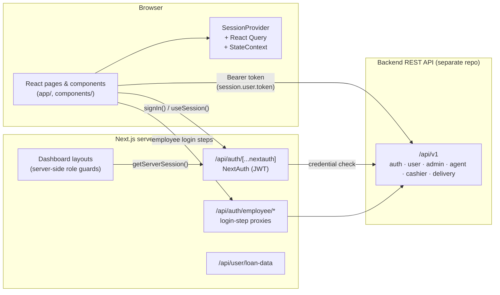
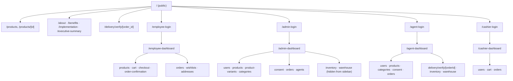
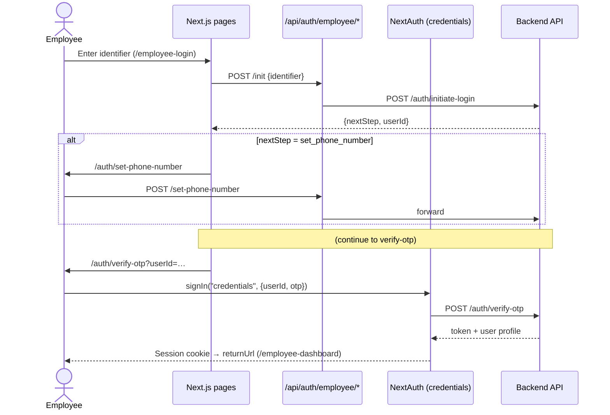
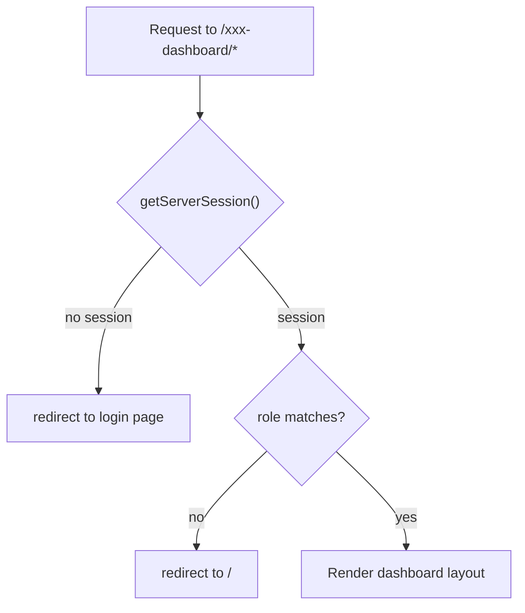
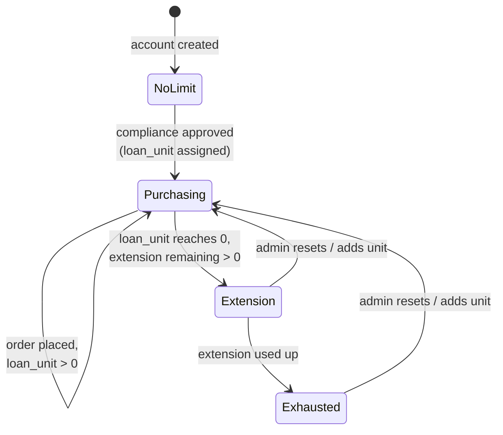
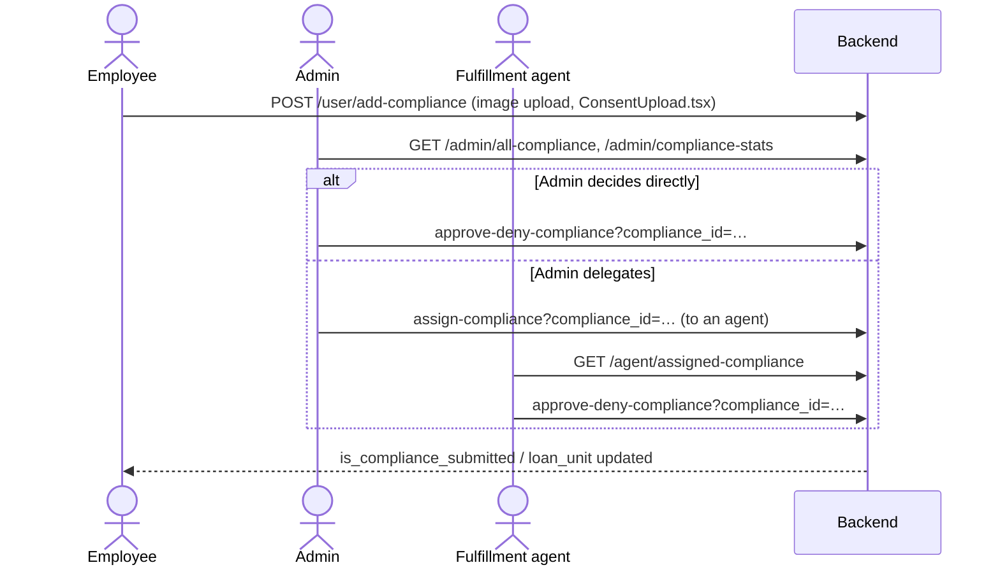
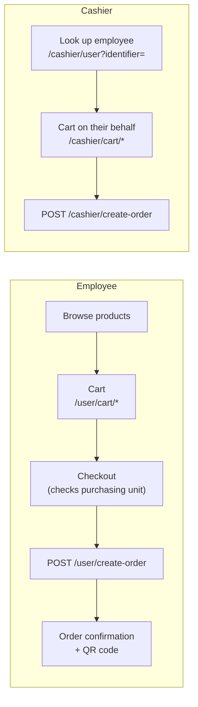
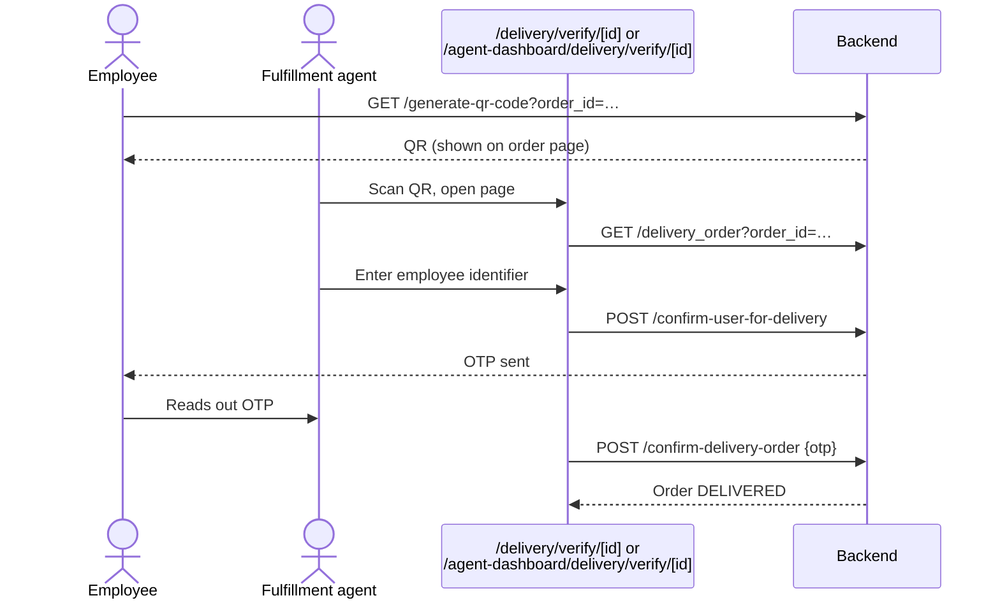

# Enugu Market — Frontend

Frontend for the **Enugu State Government food scheme marketplace**. State workers (employees) buy food staples at government-approved prices and pay through salary deductions at 0% interest. Admins, fulfillment agents and cashiers use the same app to run the scheme: users, products, compliance (consent) approval, orders and deliveries.

This README is a handover document. It covers how the app is built, how the main flows work, and the problems a new developer should know about before changing anything.

---

## Table of contents

1. [Tech stack](#1-tech-stack)
2. [Getting started](#2-getting-started)
3. [Environment variables](#3-environment-variables)
4. [Architecture overview](#4-architecture-overview)
5. [Folder structure](#5-folder-structure)
6. [Roles and route map](#6-roles-and-route-map)
7. [Authentication](#7-authentication)
8. [Core business flows](#8-core-business-flows)
9. [Talking to the backend](#9-talking-to-the-backend)
10. [UI and styling conventions](#10-ui-and-styling-conventions)
11. [Known issues and technical debt](#11-known-issues-and-technical-debt)
12. [Troubleshooting](#12-troubleshooting)
13. [Git workflow](#13-git-workflow)

---

## 1. Tech stack

| Area | Library |
| --- | --- |
| Framework | **Next.js 15.1.9** (App Router), **React 19**, TypeScript |
| Auth | **next-auth v4** (Credentials providers, JWT sessions) |
| Data fetching | `fetch` and `axios` against an external REST API; **TanStack Query** in some screens |
| Tables | TanStack Table |
| Forms | react-hook-form + zod |
| UI | Tailwind CSS 3, **shadcn/ui** (Radix primitives in [components/ui/](components/ui/)), some MUI |
| Icons | Hugeicons (main), plus lucide-react and react-icons in older screens |
| Charts | Chart.js (react-chartjs-2) and Recharts |
| Notifications | `sonner` (main), plus react-toastify in a few places |
| Files/exports | `xlsx` (Excel import/export), `jspdf` + `html2canvas` (PDF), `jsqr` + `react-webcam` (QR scanning) |
| Font | Outfit via `next/font/google` ([lib/fonts.ts](lib/fonts.ts)) |

This repo is **frontend only**. All business data lives in a separate backend REST API (`/api/v1`). The only server code here is NextAuth and a few thin proxy routes in [app/api/](app/api/).

---

## 2. Getting started

**Requirements:** Node.js 18.18+ (22 LTS recommended), npm.

```bash
npm install
# create .env.local (see section 3)
npm run dev        # http://localhost:3000
```

| Script | What it does |
| --- | --- |
| `npm run dev` | Dev server (webpack). **Do not add `--turbopack`**, see [Troubleshooting](#12-troubleshooting). |
| `npm run build` | Production build |
| `npm run start` | Serve the production build |
| `npm run lint` | ESLint (`next lint`) |
| `npx tsc --noEmit` | Type-check. Passes cleanly as of this handover. |

There is no automated test suite.

---

## 3. Environment variables

Env files are git-ignored (`.env*` in [.gitignore](.gitignore)). Ask Team Lead for real values. **Never commit them.**

| Variable | Used for | Notes |
| --- | --- | --- |
| `NEXT_PUBLIC_API_BASE_URL` | Base URL of the backend, including `/api/v1` | **Required.** Used by almost every request. Staging: `https://backend-staging.enugufoodmarket.com/api/v1`(inactive, use production or ask for production url from backend dev). Production: `https://backend-prod.enugufoodmarket.com/api/v1`. |
| `NEXTAUTH_SECRET` | Signs and encrypts the NextAuth JWT | **Required.** Use a long random string per environment. |
| `NEXTAUTH_URL` | Public URL of this frontend | Required by NextAuth in production. |
| `NEXT_PUBLIC_APP_URL` | Public URL of this frontend | Used for building links. |
| `BASE_URL` | Legacy | Present in env files. Check usage before removing. |
| `NEXT_PUBLIC_ALLOW_PROD_FALLBACK` | `"true"` lets **login requests** retry against production when staging is down (5xx or network error) | Only active when the base URL is staging. See [lib/auth.ts](lib/auth.ts) `fetchAuthWithFallback`. Keep it `false` unless you understand the consequence: a staging user logs in against production. |
| `NEXT_PUBLIC_API_URL` | Only used by [services/admin.ts](services/admin.ts) | **Not set in the env files.** Probably dead code, see [Known issues](#11-known-issues-and-technical-debt). |

> Anything prefixed `NEXT_PUBLIC_` is shipped to the browser. Never put secrets in those.

---

## 4. Architecture overview



**How a request works:**

1. The user logs in through one of the NextAuth Credentials providers. NextAuth calls the backend login endpoint and stores the returned **backend token** and user profile inside its own JWT cookie (`next-auth.session-token`, valid for 1 day).
2. Client components read `session.user.token` via `useSession()` and call the backend **directly from the browser** with `Authorization: Bearer <token>`.
3. Each dashboard `layout.tsx` is a server component. It calls `getServerSession(authOptions)` and redirects users who are not logged in or have the wrong role.

There is **no `middleware.ts`**. Route protection lives entirely in the dashboard layouts.

---

## 5. Folder structure

```
app/
├── (showNavbar)/          # Public site: has the global <Header />
│   ├── page.tsx           # Homepage (product grid first, Jumia-style)
│   ├── products/          # Public catalogue + product detail
│   ├── about/ benefits/ implementation/ executive-summary/
│   └── delivery/verify/[order_id]/   # Public delivery verification (QR target)
├── (hideNavbar)/          # Auth pages + all dashboards: no global header
│   ├── admin-login/ agent-login/ cashier-login/ employee-login/
│   ├── auth/              # Employee multi-step login: verify-otp, set-phone-number, set/verify-password, error
│   ├── admin-dashboard/   # super_admin
│   ├── agent-dashboard/   # fulfillment_officer
│   ├── cashier-dashboard/ # cashier
│   └── employee-dashboard/# user (state worker)
├── api/                   # NextAuth + thin proxy routes
└── globals.css

components/
├── ui/                    # shadcn/ui primitives: don't put business logic here
├── dashboards/
│   ├── admin/             # Admin screens (users, products, orders, consent, agents…)
│   ├── agent/             # Near-copy of admin/ for fulfillment officers
│   ├── cashiers/          # Cashier screens
│   └── users/             # Employee dashboard pieces (orders, wishlist, addresses, loan stats)
├── auth/AuthShell.tsx     # Shared layout for the login pages
├── delievery/             # QR delivery system (folder name is misspelled; imports depend on it)
└── *.tsx                  # Public-site sections, cart, checkout, header, footer…

constants/   # Sidebar/navbar menu definitions per role
hooks/       # useAuth, useCartCount, useCompliance
lib/         # auth.ts (NextAuth config), api.ts, api/compliance.ts, credit-feedback.ts, fonts, utils
providers/   # Providers.tsx (Session + React Query + StateContext)
services/    # admin.ts (legacy axios service)
types/       # Shared TS types, next-auth module augmentation
data-access/ # conversion helpers
```

The two **route groups** `(showNavbar)` and `(hideNavbar)` each have their **own root layout** (`<html>`/`<body>`). Moving between them triggers a full page load. That's expected.

---

## 6. Roles and route map

| Role (`session.user.role`) | Who | Login page | NextAuth provider id | Dashboard |
| --- | --- | --- | --- | --- |
| `super_admin` | Scheme administrators | `/admin-login` | `admin_login` | `/admin-dashboard` |
| `fulfillment_officer` | Field/fulfillment agents | `/agent-login` | `fulfillment_officer_login` | `/agent-dashboard` |
| `cashier` | Market cashiers (in-person sales) | `/cashier-login` | `cashier_login` | `/cashier-dashboard` |
| `user` | State workers / employees | `/employee-login` | `credentials` (OTP) | `/employee-dashboard` |



Sidebar entries for each role are defined in [constants/](constants/) (`adminSidebar.ts`, `agentSidebar.ts`, `cashierSidebar.ts`, `userSidebar.ts`). Add a new page there to make it show in the menu.

---

## 7. Authentication

All NextAuth config is in [lib/auth.ts](lib/auth.ts). The session type is extended in [types/next-auth.d.ts](types/next-auth.d.ts).

### 7.1 Staff login (admin, agent, cashier)

These use a plain username/email + password form that calls `signIn("<provider id>")`. The provider POSTs to `/auth/admin-login`, `/auth/fulfillment-officer-login` or `/auth/cashier-login` on the backend and maps the response into the session.

### 7.2 Employee login (multi-step, OTP)

Employees log in with an identifier (e.g. Verification ID). The backend decides the next step. The browser talks to the Next.js proxy routes in [app/api/auth/employee/](app/api/auth/employee/), which forward to the backend.



Resend OTP goes through `/api/auth/employee/resend-otp`.

### 7.3 What's in the session

`session.user` contains `id, name, email, role, token` (the **backend** bearer token) plus profile fields. For employees it also contains: `employee_id, phone, level, government_entity, salary_per_month, loan_unit, loan_amount_collected, loan_extension, max_extension_limit, is_address_set, is_compliance_submitted, verification_id`.

> **Session data goes stale.** Values like `loan_unit` are copied at login. Screens that need current numbers (e.g. checkout) re-fetch `/user/profile`. Do the same in new screens rather than trusting the session.

The session refetches every 5 minutes and on window focus ([providers/Providers.tsx](providers/Providers.tsx)). Calling `update()` from `useSession()` merges new values into the token (the `trigger === "update"` branch in the `jwt` callback).

### 7.4 Route guards



See each `app/(hideNavbar)/*-dashboard/layout.tsx`. The agent and cashier layouts redirect to `/auth/signin`, which doesn't exist (see [Known issues](#11-known-issues-and-technical-debt)).

---

## 8. Core business flows

### 8.1 Purchasing unit and extension credit

Each employee has a **purchasing unit** (`loan_unit`): their spending limit for the scheme, set once their compliance form is approved. When it runs out, they can spend from an **extension buffer** (`max_extension_limit`, roughly 10% of salary). Logic lives in [lib/credit-feedback.ts](lib/credit-feedback.ts) and [components/Checkout.tsx](components/Checkout.tsx).



Admins adjust units via [ResetPurchasingUnitDialog.tsx](components/dashboards/admin/orders/ResetPurchasingUnitDialog.tsx) and [AddUnitDialog.tsx](components/dashboards/admin/users/AddUnitDialog.tsx).

### 8.2 Compliance (consent) approval

Employees must upload a signed consent/compliance document before they can buy.



Client: [lib/api/compliance.ts](lib/api/compliance.ts) (`consentAPI`), [hooks/useCompliance.ts](hooks/useCompliance.ts), [components/ConsentUpload.tsx](components/ConsentUpload.tsx). Product pages and checkout show a banner until compliance is submitted.

### 8.3 Ordering: employee self-service and cashier-assisted



Order status values ([types/order.ts](types/order.ts)): `orderStatus` is one of `PENDING | PROCESSING | SHIPPED | DELIVERED | CANCELLED`, and `paymentStatus` is one of `PENDING | PAID | FAILED | REFUNDED`.

### 8.4 Delivery verification (QR + OTP)

Each order gets a QR code that points to the delivery verification page. At handover, the agent confirms who the employee is, then confirms delivery with an OTP.



Code: [components/delievery/QRCodeDeliverySystem.tsx](components/delievery/QRCodeDeliverySystem.tsx), [app/(showNavbar)/delivery/verify/[order_id]/page.tsx](app/(showNavbar)/delivery/verify/[order_id]/page.tsx), [app/(hideNavbar)/agent-dashboard/delivery/verify/[orderId]/page.tsx](app/(hideNavbar)/agent-dashboard/delivery/verify/[orderId]/page.tsx).

### 8.5 Bulk users and exports

Admins and agents can upload employees from Excel/CSV (`UploadUsersDialog.tsx`, template from `/agent/users-template`). They can export loans (`/admin/export-loans`) and external orders to Excel through the `xlsx` library.

---

## 9. Talking to the backend

There's **no single API client**. Most components call the backend inline like this:

```ts
const { data: session } = useSession();
await axios.get(`${process.env.NEXT_PUBLIC_API_BASE_URL}/user/cart`, {
  headers: { Authorization: `Bearer ${session?.user?.token}` },
});
```

Endpoint prefixes by role:

| Prefix | Used by | Examples |
| --- | --- | --- |
| `/auth/*` | Login | `initiate-login`, `verify-otp`, `admin-login`, `cashier-login`, `fulfillment-officer-login` |
| `/user/*` | Employee | `profile`, `cart/*`, `wishlist/*`, `address/*`, `create-order`, `all-order`, `single-order`, `add-compliance`, `get-compliance` |
| `/admin/*` | Super admin | `users`, `user`, `products`, `categories`, `warehouses`, `all-order`, `export-loans`, `repayments`, `*-compliance`, `create-fulfillment-officer` |
| `/agent/*` | Fulfillment officer | CRUD for users/products/categories/inventories/warehouses (`create-*`, `update-*?…_id=`, `delete-*?…_id=`), `upload-users`, `assigned-compliance` |
| `/cashier/*` | Cashier | `user?identifier=`, `cart/*`, `create-order`, `all-order/:id` |
| (root) | Delivery / public | `products`, `product?product_id=`, `generate-qr-code`, `delivery_order`, `confirm-user-for-delivery`, `confirm-delivery-order` |

**For new code:** put calls in a small module (like [lib/api/compliance.ts](lib/api/compliance.ts)) and use TanStack Query for loading and caching. Don't add more inline `axios` calls in components.

---

## 10. UI and styling conventions

- **Tailwind** with a custom `brand` green palette ([tailwind.config.ts](tailwind.config.ts)) and CSS variables in [app/globals.css](app/globals.css).
- **shadcn/ui** components live in [components/ui/](components/ui/) (config: [components.json](components.json), style `new-york`). Add new ones with `npx shadcn@latest add <component>`.
- Use **Hugeicons** (`@hugeicons/react` + `@hugeicons/core-free-icons`) for new UI. lucide/react-icons remain in older screens.
- Use **`sonner`** for toasts (`import { toast } from "sonner"`). A `<Toaster />` is mounted in both root layouts.
- Shared dashboard UI state (sidebar open, logout-confirm dialog) is in `CommonDashboardContext` ([providers/StateContext.tsx](providers/StateContext.tsx)).
- **Product direction:** the client wants the homepage to lead with the product grid (Jumia-style) and keep branding slim. Keep that in mind when changing the public site.

---

## 11. Known issues and technical debt

Ordered roughly by risk. Verify each one before acting on it.

**Behaviour and correctness**

1. **Broken redirect for logged-out agents and cashiers.** [agent-dashboard/layout.tsx](app/(hideNavbar)/agent-dashboard/layout.tsx) and [cashier-dashboard/layout.tsx](app/(hideNavbar)/cashier-dashboard/layout.tsx) redirect to `/auth/signin`, which has no page. They should redirect to `/agent-login` and `/cashier-login`.
2. **NextAuth config points at pages that don't exist.** The `redirect` callback in [lib/auth.ts](lib/auth.ts) sends to `/dashboard`, and `pages.newUser` is `/auth/new-user`. Neither route exists. Current login forms set their own destinations, so this mostly doesn't trigger, but clean it up.
3. **Consent modal flag mismatch.** [StatusCheckWrapper.tsx](components/StatusCheckWrapper.tsx) checks `user.is_consent_submitted`, but the session only carries `is_compliance_submitted`. The global consent popup probably never opens. Pages show their own banners instead.
4. **Hard-coded fallback backend URLs.** [lib/auth.ts](lib/auth.ts) has the production URL baked in (for `NEXT_PUBLIC_ALLOW_PROD_FALLBACK`). The public delivery page falls back to an old `onrender.com` URL if the env var is missing.
5. **The backend token is exposed to browser JavaScript.** `session.user.token` is readable by client code, so an XSS bug would leak it. Avoid `dangerouslySetInnerHTML` and treat user-supplied content carefully.
6. **No middleware.** Only dashboard layouts are guarded. Any new protected page outside those folders needs its own check.

**Code health**

7. **Duplicated dashboards.** `components/dashboards/admin/*` and `components/dashboards/agent/*` (and partly `cashiers/*`) are near-copies. A fix in one often needs to be applied to the others.
8. **Too many overlapping libraries.** There are several toast libraries (`sonner`, `react-toastify`, `react-toast`, `toast`, Radix toast), two chart libraries, three icon sets, plus MUI alongside shadcn. Standardise on sonner, Hugeicons and shadcn, and remove the others as screens are touched.
9. **Probably unused files.** `components/Login.tsx` (references old provider ids and `/admin/dashboard`), `Hero`, `Feature`, `Overview`, `Stats`, `FAQ`, `BenefitsSection`, `CartPreview`, `qr-scanner`, `providers/AuthProvider.tsx`, `providers/QueryProvider.tsx`, `services/admin.ts` (uses an unset `NEXT_PUBLIC_API_URL`). Search for imports before deleting.
10. **Template leftovers.** [constants/index.ts](constants/index.ts) contains footer/social links from an unrelated template (`cyberpatron.com`).
11. **Server-only packages in dependencies.** `jsonwebtoken` and `bcryptjs` must never be imported into client components.
12. **Heavy logging.** [lib/auth.ts](lib/auth.ts) logs a lot (with emoji) on every auth call. Tone it down for production.
13. **Version drift.** `eslint-config-next` is 15.3.0 while `next` is 15.1.9. Upgrade Next to the latest 15.x and align them.
14. **Hidden features.** Inventory and Warehouse pages exist for admins but are commented out of [constants/adminSidebar.ts](constants/adminSidebar.ts). Confirm with the client whether they're still wanted.

---

## 12. Troubleshooting

| Symptom | Cause | Fix |
| --- | --- | --- |
| `next/font/google queries have exactly one entry` | Turbopack in Next 15.1 can't parse Google's new font URLs | Run without `--turbopack` (the default `npm run dev`), or upgrade Next |
| `module factory is not available… deleted in an HMR update` | Turbopack hot-reload bug | Don't use Turbopack. Restart and clear `.next` |
| `Cannot read properties of undefined (reading 'call')` | Stale `.next/cache` (often after switching bundlers) | Stop the server, **delete the whole `.next` folder** (including `cache`), restart, hard-refresh the browser |
| Login fails with "Server configuration error" | `NEXT_PUBLIC_API_BASE_URL` not set | Fix the env file and restart (`NEXT_PUBLIC_*` values are baked in at start/build time) |
| Logged in but API calls return 401 | Backend token expired before the NextAuth session | Log out and in again. Consider handling 401 globally with `signOut()` |
| Numbers on the dashboard are outdated | Session data is copied at login | Re-fetch `/user/profile` (see 7.3) |

On Windows, clear the cache with:

```powershell
Remove-Item -Recurse -Force .next
```

---

## 13. Git workflow

- `main` is the production branch. `develop` is the integration branch, where day-to-day work happens.
- Branch off `develop`, open a PR into `develop`, then merge `develop` into `main` to release.
- Before pushing, run `npx tsc --noEmit` and `npm run lint`. There are no tests, so click through the affected role's flow by hand. Test accounts for each role are needed; get them from the backend team.
